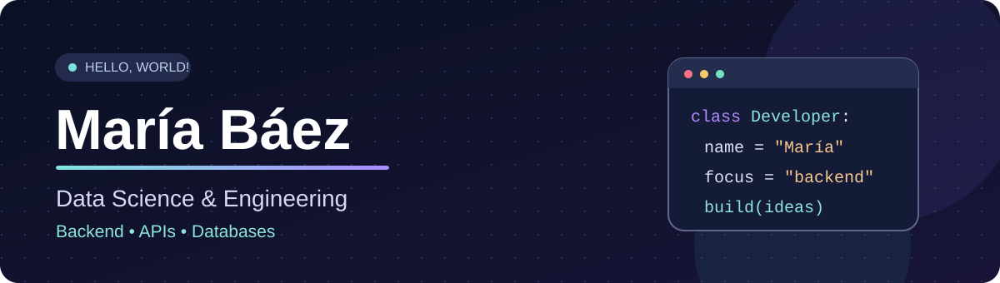

  

  ### Hi, I'm María! 👋

  **Data Science & Engineering student at ULPGC · Backend development enthusiast**

  
  

---

### 👩‍💻 About me

I'm a **third-year Data Science & Engineering student** at the **University of Las Palmas de Gran Canaria (ULPGC)**, especially interested in building clean, reliable backend applications.

- 🔧 I enjoy working with **Java, Python, REST APIs, and relational databases**.
- 🧩 I care about **readable code, modular design, and maintainability**.
- 📚 Currently exploring **software architecture, design patterns, and testing**.
- 🌊 Based in the **Canary Islands, Spain**.

### 🛠️ Tech stack

**Languages**

**Backend & tools**

### 🚀 Featured projects

| Project | What it's about | Focus |
| :--- | :--- | :--- |
| 🏖️ **BeachPlanner** | Team-built application integrating external APIs | Java · Maven · Modular architecture |
| 🗂️ **Task Manager CLI** | Command-line task management application | Application logic · CLI |
| 🍽️ **Restaurant Explorer** | Restaurant discovery project | Data handling · Application design |
| 🎬 **Movie Finder** | Movie search and exploration | APIs · Data retrieval |
| 🎥 **Movie Recommender** | Movie recommendation project | Data Science · Recommendations |

> 📌 I'll be adding direct repository links and demos as these projects are published.

### 🌱 What I'm learning

- 🔧 Backend development
- 🏗️ Software architecture and design patterns
- 🧪 Testing and code quality

### 📊 GitHub activity

Explore my [repositories](https://github.com/mariabaezz?tab=repositories) and the contribution activity on my [GitHub profile](https://github.com/mariabaezz).

  Always learning, building, and improving — one commit at a time. ✨

